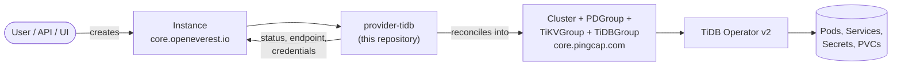

# TiDB Provider

> [!WARNING]
> **Pre-alpha.** OpenEverest v2 and this provider are under active development. CRD schemas,
> chart values and defaults change frequently, including in breaking ways, and there is no
> supported upgrade path between versions yet. Not for production use.

[](https://github.com/openeverest/openeverest)
[](https://github.com/openeverest/provider-tidb/actions/workflows/ci.yaml)
[](https://github.com/openeverest/provider-tidb/releases)
[](https://pkg.go.dev/github.com/openeverest/provider-tidb)
[](LICENSE)

Run [**TiDB**](https://github.com/pingcap/tidb) — a distributed, MySQL-compatible SQL database —
on Kubernetes through [OpenEverest](https://github.com/openeverest/openeverest), backed by
[**TiDB Operator v2**](https://github.com/pingcap/tidb-operator).

## What this is

OpenEverest providers translate a single, technology-agnostic `Instance` custom resource into
the native custom resources of an upstream Kubernetes operator. This repository is the provider
for TiDB: it owns the technology-specific knowledge — components, topologies, versions and
parameters — so that users, the API server, and the UI stay technology-agnostic.

A TiDB cluster is composed of three mandatory components plus optional TiFlash and TiProxy, each
reconciled into its own TiDB Operator v2 resource:

| Component | Role | Operator resource |
|---|---|---|
| `pd` | Placement Driver — metadata, timestamps (TSO), scheduling | `PDGroup` |
| `tikv` | Distributed key-value storage engine | `TiKVGroup` |
| `tidb` | Stateless SQL layer (MySQL protocol) | `TiDBGroup` |
| `tiflash` *(optional)* | Columnar replicas for analytical queries (HTAP) | `TiFlashGroup` |
| `tiproxy` *(optional)* | Connection proxy in front of TiDB: balances sessions and keeps them open while TiDB changes | `TiProxyGroup` |

> [!IMPORTANT]
> **This provider is not standalone.** It requires an OpenEverest installation (core CRDs and
> controller) in the cluster. Installing this chart on its own does nothing.
> See [Install OpenEverest](https://openeverest.io/documentation/current/quick-install.html).



The provider watches `Instance` resources whose `spec.providerRef.name` is `tidb`, generates a
shared `Cluster` plus one component group per component, and reports cluster health and the MySQL
connection endpoint back onto `Instance.status`. It never manages pods directly — all lifecycle
work is delegated to the operator.

## Compatibility

| provider-tidb | OpenEverest | TiDB Operator | Kubernetes |
|---|---|---|---|
| `0.2.x` | `>= 2.0.0` | `v2.0.1` | `1.30` – `1.36` |
| `0.1.x` | `>= 2.0.0` | `v2.0.1` | `1.30` – `1.36` |

Optional integrations, needed only for the features that use them:

| Feature | Requires | Tested with |
|---|---|---|
| [Monitoring](#monitoring) → Prometheus | Prometheus Operator (`PodMonitor`, `monitoring.coreos.com/v1`) | kube-prometheus-stack |
| [Monitoring](#monitoring) → VictoriaMetrics | VictoriaMetrics Operator (`VMPodScrape`, `operator.victoriametrics.com/v1beta1`) | `v0.54.1` |
| [Certificates from cert-manager](#certificates-from-cert-manager) | cert-manager | `v1.20.2` |
| [Backups and restores](#capabilities) | S3-compatible object storage | AWS S3 API, SeaweedFS |

The bundled operator manages TiDB engine versions independently (see [Versions](#versions)).

## Capabilities

What you can do to a running instance through the `Instance` API. Upgrading the provider itself
is covered under [Installation](#installation).

| Capability | Status | Notes |
|---|---|---|
| Provisioning | ✅ | PD + TiKV + TiDB, optionally TiFlash and TiProxy |
| Horizontal scaling | ✅ | Per-component `replicas`; TiKV can't be scaled in below PD's `max-replicas` (see below) |
| Vertical scaling (CPU / memory) | ✅ | Per-component `resources` |
| Custom configuration | ✅ | Inline TOML `config` per component |
| Scheduling policy | ✅ | Per-component `schedulingPolicy` (node selector, affinity, tolerations, topology spread, scheduler) |
| Version upgrades | ✅ | Change the version bundle; the operator rolls PD → TiFlash → TiKV → TiDB. TiProxy has its own version line. Downgrades are rejected |
| Monitoring | ✅ | Prometheus `PodMonitor` or VictoriaMetrics `VMPodScrape` for PD, TiKV, TiDB, TiFlash and TiProxy (see [Monitoring](#monitoring)) |
| TLS | ✅ | mTLS between components and TLS for MySQL clients, with provider-issued certificates (see [Security](#security)) |
| Connection proxy | ✅ | Optional TiProxy: session balancing and connections that survive TiDB restarts and scaling (see [TiProxy](#tiproxy)) |

Stateful components (PD, TiKV, TiFlash) additionally report:

| Capability | Status | Notes |
|---|---|---|
| Persistent storage | ✅ | Per-component size and storage class |
| Storage expansion | ✅ | Grow `storage.size`; shrinking is rejected. Needs an expandable StorageClass (see below) |
| Backups (on demand) | ✅ | Full snapshot to S3-compatible storage (BR) |
| Backups (scheduled) | ✅ | Cron schedules per storage with count or time retention (see below) |
| Point-in-time recovery | ❌ | Planned |
| Restore | ✅ | Into an existing Instance, or seed a new one via `spec.dataSource` |

See [ROADMAP.md](ROADMAP.md) for the planned work.

> [!IMPORTANT]
> Growing `spec.components.{pd,tikv,tiflash}.storage.size` resizes the existing PVCs in place, which only
> works if their StorageClass sets `allowVolumeExpansion: true`
> (`kubectl get storageclass <name> -o jsonpath='{.allowVolumeExpansion}'`). On a StorageClass
> without it — e.g. the k3s/kind `local-path` default — the TiDB Operator leaves the volumes at their
> old size. Volumes can never be shrunk; `Validate` rejects a smaller size.

> [!IMPORTANT]
> Scaling **TiKV** in takes the removed nodes offline first: the operator evicts their
> leaders and PD moves their regions to the remaining nodes before the pods are deleted. PD keeps
> `max-replicas` copies of every region (3 by default) and refuses to remove a node once fewer than
> that would remain, so `Validate` rejects such a scale-in instead of leaving it stuck. The limit is
> read from `[replication] max-replicas` in the PD `config` (as the `tidb-dev` preset sets it); PD
> only applies that setting when the cluster is created. Creating or scaling out a smaller cluster
> is still allowed.

> [!IMPORTANT]
> **TiFlash** runs while `spec.components.tiflash` is present with a replica count other than `0`
> (the UI defaults to `0`). Tables are only copied to TiFlash once you ask for it, e.g.
> `ALTER TABLE t SET TIFLASH REPLICA 1`. Setting the replica count to `0` (or removing the
> component) deletes the TiFlash nodes after the operator takes their stores offline. A store
> can't go offline while tables still need more TiFlash replicas than the nodes left, so run
> `ALTER TABLE ... SET TIFLASH REPLICA 0` on those tables before scaling TiFlash in or turning it off.
> PD also refuses to remove a store if fewer stores than its `max-replicas` (3 by default) would be
> left, so a cluster with fewer TiKV nodes than that can't turn TiFlash off.
> The Instance reports `Updating` with `tiflash (removing)` until the nodes are gone.
>
> Once a table has TiFlash replicas, the optimizer may read it from TiFlash in *any* session,
> including parts of OLTP transactions. If TiFlash is busy with analytical queries, those
> transactions slow down. Pin OLTP connections to the row store with
> `SET SESSION tidb_isolation_read_engines = 'tikv,tidb'` (or the equivalent connection parameter)
> and let analytical sessions use `'tiflash,tidb'`. To make TiKV the default for every session
> instead, set it in the TiDB `config` (TiDB pods restart one at a time to apply it); sessions can
> still opt in to TiFlash with `SET SESSION tidb_isolation_read_engines = 'tiflash,tidb'`:
>
> ```toml
> [isolation-read]
> engines = ["tikv", "tidb"]
> ```
>
> TiFlash runs analytical joins and aggregations in memory: give it at least 32Gi, which is what
> the `tidb-analytics` preset uses.

> [!NOTE]
> TiDB Operator v2 has no controller for `BackupSchedule`, so the provider runs
> `spec.backup.storages[].schedules` itself: each cron slot creates a `Backup` (with
> `spec.scheduleName`) that runs like an on-demand one. A slot fires only while the Instance is
> `Ready` or `Updating` and no earlier run of the same schedule is in progress, and is skipped if
> it can't start within 10 minutes. Retention is anchored on successful backups: `count: N` keeps
> the N newest successful backups, and `time` keeps everything inside the window plus the newest
> successful backup. Pruned backups follow their own `deletionPolicy`. An invalid cron expression
> sets the `BackupConfigured` condition to `False` with reason `BackupScheduleInvalid`.

## Installation

The provider chart is published as an OCI artifact:

```bash
helm install provider-tidb \
  oci://ghcr.io/openeverest/charts/provider-tidb \
  --version <chart-version> \
  --namespace everest-system
```

The chart is self-contained:

- **TiDB Operator v2 is bundled** as a chart dependency and installed automatically. Disable it
  with `--set operator.enabled=false` to run against an externally managed operator.
- **The TiDB CRDs are installed by a pre-install hook.** They are ~15 MB — too large to ship
  inside the Helm release — so a `Job` applies the pinned CRD manifest from the operator's GitHub
  release before the operator and provider start. This requires cluster egress to that URL; point
  `--set crds.url=...` at a mirror for air-gapped clusters, or `--set crds.install=false` to manage
  the CRDs yourself.

Upgrade and uninstall:

```bash
helm upgrade provider-tidb oci://ghcr.io/openeverest/charts/provider-tidb \
  --version <chart-version> --namespace everest-system
helm uninstall provider-tidb --namespace everest-system
```

Uninstalling the chart does **not** delete running `Instance` resources, the TiDB CRDs, or any
data.

### Upgrading from 0.1.x

- Existing Instances are left as they are: the provider does not restart their pods or change
  their TiDB resources, and they stay plaintext. TLS ([Security](#security)) can only be chosen
  when an Instance is created; new Instances get it by default in the UI.
- The chart grants the provider new permissions: ServiceAccounts, Roles and RoleBindings (for the
  account BR jobs run as), `PodMonitor`s, `VMPodScrape`s and cert-manager `Issuer`s and
  `Certificate`s. `helm upgrade --reuse-values` works.
- BR backup and restore jobs could not start in 0.1.x
  ([#63](https://github.com/openeverest/provider-tidb/issues/63)). A `Backup` or `Restore` still
  `Running` from before the upgrade keeps waiting for a job that cannot start; delete it and
  create it again.

### Air-gapped installs

Set `--set crds.install=false` to skip the CRD network pull entirely, then install the CRDs
yourself first (server-side apply is required — the schemas exceed the client-side limit):

```bash
# From your own mirror of the pinned manifest:
kubectl apply --server-side -f tidb-operator.crds.yaml

helm install provider-tidb oci://ghcr.io/openeverest/charts/provider-tidb \
  --version <chart-version> --namespace everest-system \
  --set crds.install=false
```

Alternatively keep the hook and only repoint it at an internal mirror with
`--set crds.url=https://mirror.internal/tidb-operator.crds.yaml`.

## Usage

Verify that the provider registered itself:

```bash
kubectl get providers.core.openeverest.io tidb
```

Create an instance:

```yaml
apiVersion: core.openeverest.io/v1alpha1
kind: Instance
metadata:
  name: my-tidb
spec:
  providerRef:
    name: tidb
  version: "8.5.2"
  topology:
    type: cluster
  components:
    pd:
      type: pd
      replicas: 3
      storage:
        size: 20Gi
    tikv:
      type: tikv
      replicas: 3
      storage:
        size: 50Gi
    tidb:
      type: tidb
      replicas: 2
```

`spec.version` and `spec.topology` are optional; the provider defaults apply (PD 3, TiKV 3,
TiDB 2, default version bundle). More examples live in [examples/](examples/).

Watch it come up and read the connection details:

```bash
kubectl get instances.core.openeverest.io my-tidb -w
kubectl get instances.core.openeverest.io my-tidb -o jsonpath='{.status.connectionSecretRef.name}'
```

The connection secret holds the MySQL `host`, `port` (4000, or 6000 through [TiProxy](#tiproxy)),
`username` (`root`) and `password`.
The provider generates a random `root` password on first bootstrap (via the operator's
`bootstrapSQL`), stores it in a Secret, and surfaces it here. Connect with any MySQL client:

```bash
mysql -h my-tidb-tidb.<namespace> -P 4000 -u root -p"$(kubectl get secret my-tidb-conn -o jsonpath='{.data.password}' | base64 -d)"
```

A BR restore brings back the backed-up cluster's users and grants (`mysql.user` and the other
privilege tables), root's password included. So the connection Secret keeps working, each backup
records the root password of the Instance it was taken from, and after a restore the restored
Instance's connection Secret switches to that password. A clone made from another Instance's backup
therefore has the source's root password; change it with `ALTER USER` and update
`<instance>-tidb-root` if they should differ. For backups taken by an earlier provider version the
source Instance's current root password is used, and if that Instance is gone the Restore's message
says the password is unknown.

> [!NOTE]
> Each component group expands into one instance resource per replica — e.g. `spec.components.tidb.replicas: 2`
> yields two `TiDB` resources (`kubectl get tidb`) and two pods, all belonging to one `TiDBGroup`
> (`kubectl get tidbgroup`). This mirrors how a Deployment owns its Pods.

### Presets

The chart ships `InstancePreset`s, so the UI can create a working cluster in one click:

| Preset | PD | TiKV | TiDB | TiFlash | TiProxy | Use it for |
|---|---|---|---|---|---|---|
| `tidb-dev` | 1 | 1 | 1 | — | — | A laptop or CI: the smallest cluster that runs (about 4 GiB) |
| `tidb-standard` | 3 | 3 | 2 | — | 2 | A highly available transactional database |
| `tidb-analytics` | 3 | 3 | 2 | 2 | 2 | Transactions plus analytics on the same data |

`tidb-dev` has no redundancy and sets PD's `max-replicas` to `1`, so PD stops trying to place
three copies of the data on its single TiKV node. To try TiFlash on it, add a `tiflash`
component with at least 4 GiB of memory; TiFlash is killed for running out of memory at 3 GiB.
Presets pin the default version bundle; a unit test fails if they fall behind it. Sizes and the
list itself
live under `presets:` in [values.yaml](charts/provider-tidb/values.yaml); set `enabled: false`
to hide one.

### TiProxy

[TiProxy](https://docs.pingcap.com/tidb/stable/tiproxy-overview) is a MySQL-protocol proxy in
front of TiDB. Clients connect to TiProxy, which:

- balances sessions across the TiDB nodes, and keeps rebalancing them: after a scale-out it
  migrates existing sessions to the new TiDB nodes, not just new connections;
- keeps client connections open while TiDB nodes are restarted (rolling upgrades, configuration
  changes) or removed by a scale-in, by migrating each session to another TiDB node first.

It runs while `spec.components.tiproxy` is present with a replica count other than `0` (the UI's
**Connection proxy (TiProxy)** section defaults to `0`; the `tidb-standard` and `tidb-analytics`
presets run two TiProxy nodes):

```yaml
spec:
  components:
    tiproxy:
      type: tiproxy
      replicas: 2
      resources:
        limits: {cpu: "2", memory: 2Gi}
```

Setting the replica count to `0` (or removing the component) deletes the TiProxy nodes; the
Instance reports `Updating` with `tiproxy (removing)` until they are gone.

> [!IMPORTANT]
> **Turning TiProxy on or off changes the connection endpoint.** While TiProxy runs, the
> connection Secret points at TiProxy's Service `<instance>-tiproxy.<namespace>`, port `6000`;
> without it, at TiDB's `<instance>-tidb.<namespace>`, port `4000`. The Secret switches once the
> Instance is `Ready` again. Both Services keep working while both exist, so move clients over
> before turning TiProxy off: their connections through TiProxy are closed with it.

TiProxy has its own version line, independent of TiDB: every version bundle runs TiProxy
`v1.3.3`; set `spec.components.tiproxy.version` to pick another one from
[definition/versions.yaml](definition/versions.yaml). It is not ordered against the TiDB
components, but downgrades are still rejected. Other settings go in
`spec.components.tiproxy.parameters.config` as TOML
([TiProxy configuration](https://docs.pingcap.com/tidb/stable/tiproxy-configuration)).

With [TLS](#security), TiProxy follows the Instance's settings: with `tls.client` it serves MySQL
clients over TLS with a certificate for `<instance>-tiproxy` signed by the CA in the connection
Secret (client certificates are optional, as with TiDB) and connects to TiDB over TLS as well; with
`tls.cluster` it uses mTLS towards PD and TiDB's status port and serves its API (and metrics) over
https.

**Session migration needs a shared signing certificate.** TiProxy moves a session with a token
the old TiDB node signs and the new one verifies, so all TiDB nodes need the same certificate. The
provider issues one into `<instance>-session-token-signing-secret` (also without TLS) and turns on
TiDB Operator's `SessionTokenSigning` feature gate, which mounts it into TiDB. TiDB Operator only
lets feature gates change on a `Cluster` that already has `FeatureModification` on, so:

- an Instance **created with TiProxy** gets both gates (`FeatureModification`,
  `SessionTokenSigning`) from the start, and nothing restarts;
- turning TiProxy **on for an existing Instance** first turns on `FeatureModification`, which
  updates the operator's resources in place without restarting any pod. Once every TiDB node
  carries it, the provider turns on `SessionTokenSigning`, and the operator **replaces the TiDB
  pods one at a time** (a new pod starts before an old one stops). TiProxy balances connections
  from the start, but sessions on the TiDB pods that predate the signing certificate cannot be
  migrated, so this one roll closes them. Expect the Instance to be `Updating` until it is done.

The gates and the signing certificate stay when TiProxy is turned off, so turning it on again
does not restart TiDB.

**TiDB waits for TiProxy when it stops.** TiProxy moves a session only between transactions, and
only while its TiDB node still runs. When a TiDB pod stops, TiDB Operator first lets it serve for
10 more seconds, then TiDB reports itself unhealthy for
[`graceful-wait-before-shutdown`](https://docs.pingcap.com/tidb/stable/tidb-configuration-file#graceful-wait-before-shutdown-new-in-v50)
seconds, which is when TiProxy moves the sessions away, and then closes the connections left. TiDB
defaults it to `0`, which leaves TiProxy no time, so along with `SessionTokenSigning` the provider
sets `graceful-wait-before-shutdown = 15` in the TiDB config. TiDB Operator kills a TiDB pod 30
seconds after it starts stopping, so 15 leaves TiDB the last 5 seconds to close what is left.
Set `graceful-wait-before-shutdown` in the TiDB `config` yourself to use another value (PingCAP
recommends 10 seconds more than your longest transaction; values above 20 are cut short).

The provider only adds the setting when TiDB restarts anyway: on an Instance created with TiProxy,
and in the same step that turns on `SessionTokenSigning` on an existing one, so both land in one
roll. Like the gates, it stays when TiProxy is turned off.

### Monitoring

PD, TiKV, TiDB, TiFlash and TiProxy serve Prometheus metrics natively, so no exporter is needed.
The **Monitoring** section of the UI (`spec.topology.parameters.monitoring`) has a toggle per
monitoring system; each makes the provider create one scrape object for every component's
metrics endpoint (`/metrics`, and `/api/metrics` on TiProxy's API port):

| Toggle | Creates | Requires |
|---|---|---|
| **Prometheus** (`monitoring.prometheus`) | `PodMonitor` `<instance>-metrics` | [Prometheus Operator](https://prometheus-operator.dev/) |
| **VictoriaMetrics** (`monitoring.victoriaMetrics`) | `VMPodScrape` `<instance>-vm-metrics` | [VictoriaMetrics Operator](https://docs.victoriametrics.com/operator/) |

```yaml
spec:
  topology:
    type: cluster
    parameters:
      monitoring:
        prometheus:
          enabled: true
          interval: 30s                       # optional; defaults to the global scrape interval
          podMonitorLabels:                   # optional; see below
            release: kube-prometheus-stack
        victoriaMetrics:
          enabled: true
          interval: 30s                       # optional
          podScrapeLabels: {}                 # optional; see below
```

Both objects are owned by the Instance and removed when their toggle is turned off. They carry
the `app.kubernetes.io/managed-by: everest` and `app.kubernetes.io/instance: <instance>` labels
the [Metrics plugin](https://github.com/openeverest/plugin-metrics) finds a `PodMonitor` by, so its
*Metrics* tab shows the built-in TiDB dashboard for Prometheus. Validation rejects turning a
toggle on while its CRD is not installed.

A monitoring system only scrapes the objects its selector matches. kube-prometheus-stack, for
example, selects `PodMonitor`s labelled `release: <its release name>`; a `VMAgent` with
`selectAllByDefault: true` takes every `VMPodScrape`. Set the labels once
for every Instance with the chart's `podMonitor.labels` / `vmPodScrape.labels`, or per Instance
with `podMonitorLabels` / `podScrapeLabels` (which win on conflicts).

> [!NOTE]
> Turn on the toggle of the monitoring system you run; the provider creates its scrape object
> itself rather than relying on a VictoriaMetrics Operator converting the `PodMonitor`. If your
> VictoriaMetrics Operator does convert Prometheus Operator objects, it also turns the
> `PodMonitor` into a `VMPodScrape` named `<instance>-metrics`, so with both toggles on a
> `VMAgent` scrapes every component twice.

### Security

New Instances encrypt their traffic by default. The **Security** section of the UI
(`spec.topology.parameters.tls`) has two toggles, both on by default:

| Toggle | Field | Effect |
|---|---|---|
| Encrypt traffic between components (mTLS) | `tls.cluster` | PD, TiKV, TiDB, TiFlash and TiProxy authenticate each other with certificates and encrypt their traffic |
| Encrypt client connections (TLS) | `tls.client` | MySQL clients can connect to TiDB (and [TiProxy](#tiproxy)) over TLS |

```yaml
spec:
  topology:
    type: cluster
    parameters:
      tls:
        cluster: true
        client: true
```

Both are chosen when the Instance is created and cannot be changed afterwards: TiDB Operator
does not switch an existing cluster between plaintext and TLS. An Instance without the field
(for example one created before this setting existed) stays plaintext.

The provider generates a CA for each Instance (`<instance>-tls-ca`) and issues every
certificate from it into the Secrets the operator mounts: `<instance>-{pd,tikv,tidb,tiflash}-cluster-secret`,
`<instance>-cluster-client-secret` (used by the operator and by BR backups) and
`<instance>-tidb-server-secret` (TiDB's MySQL certificate). While [TiProxy](#tiproxy) is enabled it
also issues `<instance>-tiproxy-cluster-secret`, `<instance>-tiproxy-server-secret` (TiProxy's
MySQL certificate) and `<instance>-tiproxy-tidb-secret` (TiProxy's client certificate towards
TiDB), plus `<instance>-session-token-signing-secret` with or without TLS. They are deleted with
the Instance.

With client TLS, the connection Secret `<instance>-conn` carries the CA as `ca.crt`, and the
published host is in TiDB's (or TiProxy's) certificate, so clients can verify both:

```bash
kubectl get secret <instance>-conn -o jsonpath='{.data.ca\.crt}' | base64 -d > ca.crt
mysql -h <host> -P 4000 -u root -p --ssl-mode=VERIFY_IDENTITY --ssl-ca=ca.crt
```

TiDB still accepts plaintext connections unless you require TLS, e.g. with
`ALTER USER ... REQUIRE SSL` or by setting `require_secure_transport`.

With mTLS, the [monitoring](#monitoring) `PodMonitor` and `VMPodScrape` scrape over https
with the cluster client certificate.

> [!NOTE]
> The certificates are valid for ten years and are not rotated yet: TiDB Operator does not
> reload its own client certificate, and TiDB only picks up a new MySQL certificate after
> `ALTER INSTANCE RELOAD TLS`.

#### Certificates from cert-manager

With [cert-manager](https://cert-manager.io/) installed, the certificates can come from it
instead (**Issue certificates with cert-manager** in the UI):

```yaml
      tls:
        cluster: true
        client: true
        certManager:
          enabled: true
          issuerRef:                # optional
            name: corp-ca
            kind: ClusterIssuer     # or Issuer (default), in the Instance's namespace
```

- Without `issuerRef`, the provider sets up a CA in cert-manager for the Instance: a
  self-signed `Issuer`, a CA `Certificate` (`<instance>-tls-ca`) and a CA `Issuer` that signs the rest.
- With `issuerRef`, your issuer signs every certificate. It must write the CA into the Secrets
  (`ca.crt`), as CA and Vault issuers do; ACME issuers cannot be used.

The provider creates one `Certificate` per Secret listed above, valid for ten years, and makes
each Secret cert-manager writes owned by its `Certificate`, so they are deleted with the Instance.
The certificate source is chosen at creation, like the toggles. If your issuer caps certificates
at a shorter lifetime, cert-manager renews them earlier; restart TiDB Operator after a renewal
and run `ALTER INSTANCE RELOAD TLS` on each TiDB to pick up the new certificates.

## Topologies

| Topology | Default | Description |
|---|---|---|
| `cluster` | ✅ | Standard distributed TiDB: PD + TiKV + TiDB, optionally TiFlash and TiProxy |

## Versions

| Version bundle | Default | Components |
|---|---|---|
| `8.5.2` | ✅ | PD / TiKV / TiDB / TiFlash `v8.5.2`, TiProxy `v1.3.3` |
| `7.5.5` |  | PD / TiKV / TiDB / TiFlash `v7.5.5`, TiProxy `v1.3.3` |

Source of truth: [definition/versions.yaml](definition/versions.yaml). Each bundle pins the TiDB
components to the same TiDB release, and TiProxy to a release of its own version line (`v1.3.3`
or `v1.3.2` via `spec.components.tiproxy.version`); the user selects one via `Instance.spec.version`.

## Configuration

- **Chart values:** [charts/provider-tidb/values.yaml](charts/provider-tidb/values.yaml) — provider
  deployment settings and the bundled `operator` subchart values.
- **Instance parameters:** per-component `config` (inline TOML) and per-topology parameters,
  defined under [definition/](definition/) and published on the `Provider` resource
  (`kubectl get provider tidb -o yaml`). The API server and the UI validate user input against
  these schemas.

## Development

Requires Go (see [go.mod](go.mod)), Docker, Helm, kubectl, and a Kubernetes cluster you can
reach. [dev/README.md](dev/README.md) covers the environment end to end: the recommended
local k3d setup, running against a cluster you already have, and every `dev/.env` setting.

```bash
make dev-up             # local cluster + Tilt dev environment (see dev/README.md)
make generate           # RBAC, provider spec, Helm chart sync
make run                # run the provider locally against the cluster
make test-unit
make test-integration   # chainsaw suites under test/integration/
make dev-down
```

`make help` lists every target. `make verify` fails when generated files are stale — run
`make generate` and commit the result.

The provider contract (`Validate` / `Sync` / `Status` / `Cleanup`), RBAC markers, watches,
code generation, and the backup/restore interfaces are documented once for all providers in
[PROVIDER_DEVELOPMENT.md](https://github.com/openeverest/provider-sdk/blob/main/PROVIDER_DEVELOPMENT.md).

### Layout

| Path | Purpose |
|---|---|
| `cmd/provider/` | Entry point |
| `internal/provider/` | `ProviderInterface` implementation (Sync/Validate/Status/Cleanup), RBAC markers |
| `internal/common/` | Component name constants |
| `definition/` | Provider identity, component types, versions, topologies |
| `charts/provider-tidb/` | Helm chart — bundles the operator subchart and TiDB `crds/`; `generated/` is produced by `make generate` |
| `config/rbac/role.yaml` | Generated `ClusterRole` — do not edit |
| `test/integration/` | Chainsaw suites (see its `README.md`) |
| `test/vars.sh` | Pinned operator and engine versions used by tests |
| `examples/` | Example `Instance` resources |
| `dev/` | Tilt dev environment, `.env` configuration, k3d cluster config |
| `.github/workflows/` | CI: lint, build, unit and integration tests, release |

### Testing

- **Unit tests** — `make test-unit` (mapping helpers + the provider-runtime conformance suite,
  which asserts every UI-schema field is reconciled by `Sync`).
- **Integration tests** — chainsaw suites under `test/integration/`. The `core/` suite exercises
  the full lifecycle: create an `Instance`, assert the provider produces the `Cluster` and
  component groups, simulate operator readiness, assert the `Instance` reports `Ready`, and delete.
  The operator itself is disabled for these tests (readiness is simulated). See
  [test/integration/README.md](test/integration/README.md).
- **CI** — `.github/workflows/ci.yaml` runs lint, build, unit tests, generated-file
  verification, Helm lint, and each integration suite on every pull request.

## Troubleshooting

```bash
kubectl logs -n everest-system deploy/provider-tidb -f
```

| Symptom | Where to look |
|---|---|
| `Instance` stuck in `Provisioning` | `kubectl describe instances.core.openeverest.io <name>` conditions, then the provider logs |
| No `Provider` resource in the cluster | Is the chart installed? Check the provider deployment logs |
| `Instance` ignored entirely | `spec.providerRef.name` must be `tidb` |
| Provider logs `no matches for kind "TiKVGroup"` | TiDB CRDs missing. The chart's pre-install hook installs them; check the `<release>-crd-installer` Job (and its egress to `crds.url`), or apply them manually: `kubectl apply --server-side -f <crds.url>` |
| Operator pod `CrashLoopBackOff` at startup | The TiDB CRDs must exist before the operator starts (see the row above) |
| Groups created but no pods | Inspect the group/instance status (`kubectl get tidbgroup,tikvgroup,pdgroup`) — the failure is upstream in the operator |
| Storage size raised but PVCs unchanged | The StorageClass must allow volume expansion; check `kubectl get pvc` and the operator logs |
| `Instance` turns `Failed` right after an edit, with no message | The provider rejected the change. The reason is in the provider logs (`Validation failed`); see [Known issues](#known-issues). Typical causes: shrinking storage, downgrading or reordering versions, scaling TiKV below PD's `max-replicas`, changing TLS after creation. Revert the change to return to `Ready` |
| `Backup` or `Restore` stays `Running` | `kubectl get jobs` in the Instance's namespace and the BR job's pod logs; the BR `Backup`/`Restore` (`backups.br.pingcap.com`) conditions carry the reason |
| TiProxy runs but does not migrate sessions | `kubectl get cluster.core.pingcap.com <instance> -o jsonpath='{.spec.featureGates}'` must list `SessionTokenSigning`. On an existing Instance the provider adds it only once every TiDB instance lists `FeatureModification` (`kubectl get tidb -o jsonpath='{.items[*].spec.features}'`); see [TiProxy](#tiproxy) |
| Clients cannot log in after a restore | The restored data carries the backed-up cluster's root password; see [Usage](#usage). The Restore's message says when that password is unknown |

## Known issues

- **Rejected changes show no reason.** When `Validate` rejects a change the `Instance` turns
  `Failed` without a message; the reason is only in the provider logs. Fixed in the OpenEverest
  provider runtime (openeverest/openeverest#3346) and picked up once a release includes it.
- **No certificate rotation** ([#66](https://github.com/openeverest/provider-tidb/issues/66)).
  Certificates are issued for ten years and not renewed (see [Security](#security)).

## Contributing

Issues and pull requests are welcome. See
[PROVIDER_DEVELOPMENT.md](https://github.com/openeverest/provider-sdk/blob/main/PROVIDER_DEVELOPMENT.md)
and the [OpenEverest Code of Conduct](https://github.com/openeverest/openeverest/blob/main/CODE_OF_CONDUCT.md).

## Security

Report vulnerabilities per the
[OpenEverest security policy](https://github.com/openeverest/openeverest/blob/main/SECURITY.md).
Please do not open public issues for security reports.

## License

Apache License 2.0 — see [LICENSE](LICENSE) for details.
